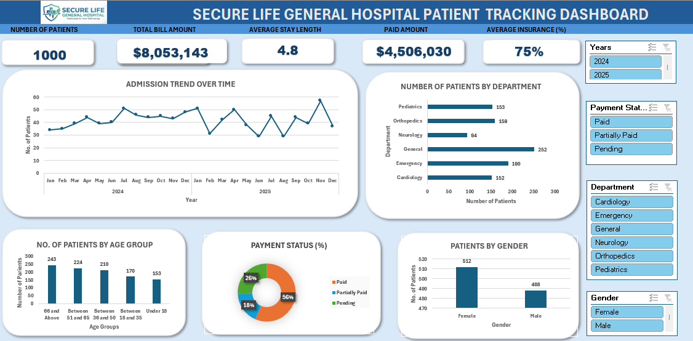

# A SECURE LIFE GENERAL HOSPITAL PATIENT TRACKING DASHBOARD

## Data Analytics MS Excel Portfolio Project 
## Made by: WAMANGA MARK

## 1. Introduction
Hospitals handle a large amount of information every day, from patient admissions and medical conditions to treatment costs and insurance payments. However, this information becomes more useful when it is properly analysed and presented in a way that supports decision-making.
In this project, I analysed patient admission, billing and insurance data for Secure Life General Hospital using Microsoft Excel. I developed an interactive dashboard to give hospital management a clearer picture of patient visits, departmental performance, financial activities and service demand.
My main objective was to turn raw patient records into meaningful insights that could help management understand what is happening within the hospital, identify areas requiring attention and make better operational and financial decisions.

## 2. About the Dataset
The dataset provided for this project contains 1,000 patient visit records covering the period January 2024 to December 2025.
It consists of 15 columns covering different aspects of hospital operations, including:

•	**Patient information:** Patient ID, age, age group and gender.

•	**Admission details:** Admission date, discharge date and hospital department.

•	**Medical information:** Diagnosis recorded for each patient visit.

•	**Financial information:** Total bill amount, insurance coverage, estimated insurance amount and patient responsibility.

•	**Payment information:** Payment status and amount paid.

•	**Hospital stays:** Length of stay for each patient visit.
The dataset was explored and analysed using Microsoft Excel. I used PivotTables, Excel formulas and Pivot Charts to summarise the information and create an interactive dashboard.
Each record represents one patient visit, meaning that the analysis focuses on visits rather than counting unique individuals.

## 3. Problem Statement
Secure Life General Hospital management identified changes in patient admissions, outstanding medical bills and variations in insurance coverage across departments.
However, the hospital lacked a consolidated report that could provide a clear overview of its operational and financial performance.
Without this information being presented in an organised way, it becomes difficult to identify departments with higher patient demand, understand billing patterns, monitor outstanding payments and assess how insurance coverage differs across services.
As the data analyst for this project, I was tasked with analysing the available records and developing an interactive Excel dashboard to address these challenges.

The analysis focused on answering questions such as:
 - How many patient visits has the hospital recorded?
 - Which departments receive the highest number of patients?
 - Which departments generate the highest total bills?
 - What is the average length of stay across departments?
 - What proportion of patient bills is paid, pending or partially paid?
 - How much has the hospital billed, and how much remains outstanding?
 - How does insurance coverage vary across departments and diagnoses?
 - Which age groups account for the highest number of patient visits?
 - How do admissions and billing amounts change over time?
 - Which areas require management attention?
 
## 4. Dashboard Visualization
I developed an Excel dashboard to bring the hospital's key performance indicators and analysis into one view.
The dashboard presents information on:

 •	Total patient visits.

 •	Total billing and paid amounts.

 •	Average patient length of stay.

 •	Patient distribution across departments.

 •	Age and gender distribution.

 •	Payment status.

 •	Monthly admission patterns.

 •	Other relevant hospital performance indicators.
The visualisations allow users to explore the information and identify patterns without having to review individual patient records.

## Dashboard Preview

## 5. Key Insights and Findings
The analysis of the 1,000 patient visit records revealed several findings that could help hospital management understand its performance.
### 5.1 Patient Admissions
The hospital recorded 1,000 patient visits during the two-year period. Female patients accounted for 512 visits (51.2%), while male patients accounted for 488 (48.8%).
The distribution was relatively balanced, showing that both groups contributed almost equally to the hospital's patient visits.
### 5.2 Departmental Performance
The General Department recorded the highest number of visits, with 252 (25.2%), followed by Emergency with 190 visits (19%).
However, the department generating the highest total bills was Orthopaedics, with approximately 2.55 million, representing 31.7% of total hospital billing.
Cardiology followed with approximately 2.10 million (26%).
This shows that departments handling the highest number of visits are not necessarily the ones generating the highest bills. Orthopaedics and Cardiology contribute a larger share of billing despite receiving fewer visits than General.
### 5.3 Patient Length of Stay
The average hospital stay was approximately 4.8 days.
Orthopaedics recorded the longest average stay at 8.4 days, followed by Neurology at 6.9 days and Cardiology at 6.5 days.
Emergency had the shortest average stay at approximately 2 days.
These differences suggest that some departments require longer treatment periods and may place greater demand on hospital beds and other resources.
### 5.4 Payment and Billing Performance
The hospital recorded approximately 8.05 million in total bills, against approximately 4.57 million recorded as paid.
This represents about 56.7% of total billing, leaving approximately 3.48 million not recorded as paid.
The payment status distribution was:

 •	**Paid:** 564 visits (56.4%).

 •	**Pending:** 257 visits (25.7%).

 •	**Partially Paid:** 179 visits (17.9%).
This indicates that a considerable proportion of patient accounts requires financial follow-up.
### 5.5 Insurance Coverage
The average insurance coverage across the dataset was approximately 74.9%.
At department level, average coverage ranged from approximately 74% in General and Paediatrics to 76% in Cardiology and Emergency.
Insurance coverage also varied by diagnosis. For example, coronary artery disease recorded an average coverage of approximately 83%, while Stroke recorded approximately 82%.
These differences show why management should monitor insurance coverage at both department and diagnosis levels when reviewing billing and patient financial responsibilities.
### 5.6 Patient Age Groups
Patients aged 66 and above accounted for the highest number of visits, with 243 (24.3%).
This was followed by:

 •	**Ages 51–65:** 224 visits (22.4%).

 •	**Ages 36–50:** 210 visits (21%).

 •	**Ages 18–35:** 170 visits (17%).

 •	**Under 18:** 153 visits (15.3%).
The findings show that older adults make up a substantial proportion of hospital visits, which may be important when planning patient care and healthcare resources.
### 5.7 Admission and Billing Trends
The hospital recorded 508 visits in 2024 and 492 visits in 2025.
Total billing was approximately 4.13 million in 2024 and 3.92 million in 2025.
This indicates a slight decrease in both recorded visits and total billing in 2025 compared with 2024.
November 2025 recorded the highest monthly admission volume, with 57 visits.
Management could investigate the factors behind these changes to understand whether they relate to patient demand, service utilisation or other operational factors.

## 7. Recommendations
Based on the analysis, I recommend the following actions:
 - Improve resource allocation across departments. The General Department handles the highest number of visits, while Orthopaedics and Cardiology generate the largest bills. Management should consider both patient volume and treatment requirements when planning staffing, equipment and bed capacity.
 - Strengthen payment monitoring. With approximately 3.48 million not recorded as paid, the hospital should improve follow-up of pending and partially paid accounts and regularly reconcile patient bills with recorded payments.
 - Review insurance arrangements. Management should monitor differences in insurance coverage across departments and diagnoses to improve billing processes and understand patient financial responsibilities.
 - Plan for different patient age groups. The high number of visits among patients aged 66 and above highlights the importance of planning appropriate services and resources for older patients.
 - Monitor admission and billing trends. Regular reviews of monthly admissions and billing can help management identify changes in demand and plan resources accordingly.
 - Strengthen data management and reporting. The hospital should maintain accurate, regularly updated records and use performance dashboards to support routine operational and financial reviews.
  
## 8. Conclusion
 - This project demonstrates how Microsoft Excel can be used to turn raw healthcare data into useful information for management decision-making.
 - Through data analysis, PivotTables, formulas and visualisations, I was able to examine patient visits, departmental performance, hospital stays, insurance coverage and billing activities.
 - One of the key findings was that the department receiving the highest number of patient visits was not necessarily the department generating the highest billing. Orthopaedics for example, recorded fewer visits than General but contributed the largest share of total billing.
 - The analysis also highlighted outstanding payments and differences in insurance coverage, which are important areas for management attention.
Overall, this project strengthened my practical skills in data cleaning, Excel analysis, dashboard development and communicating findings in a simple and meaningful way.
 - It also demonstrated the value of data in helping organisations move beyond recording activities to understanding performance and identifying opportunities for improvement.

